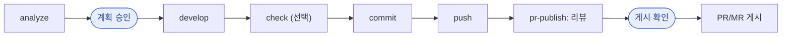

# devkit

[English](README.md) | 한국어

어떤 저장소, 어떤 업무 도메인에서도 같은 개발 흐름을 갖추게 해 주는 Claude Code 팀 개발 키트다. 프로젝트 규칙을 미리 싣지 않고, 특정 작업 트래커(Jira, Notion, Obsidian, GitHub Issues …)에도 의존하지 않는다. 담긴 것은 **작업 흐름**(분석 → 구현 → 검증 → 커밋 → 푸시 → PR/MR), **작업 원칙**(최소 범위, 확인한 것만 주장, 선택적 검증, 사람 승인 지점), 그리고 **저장소마다 근거 기반으로 규칙과 스킬을 키워 가는 도구**다.

스킬과 문서는 영어로 쓰여 있다. Claude는 사용자의 언어로 답하고, `devkit:setup`은 인터뷰에서 고른 언어로 저장소 문서를 쓴다.

## 구성

| 단계 | 이름 | 하는 일 |
|---|---|---|
| 상시 | 세션 훅 `using-devkit` | 세션 시작·재개·clear·압축 시점에 판단 원칙(6줄)을 주입한다. 저장소의 `CLAUDE.md`와 `docs/rules/`가 우선한다 |
| 상시 | 가드 훅 `hooks/guard.py` | 셸 명령 실행 직전에 Git·서버 기동 규칙을 코드로 강제한다 ("가드 훅" 참고) |
| 분석 | `/devkit:analyze` | 어떤 출처의 요구사항·이슈·버그든 읽고, 현재 코드 추적 → 차이 → 영향 → 공통 위험 점검 → 구현 계획을 분석 문서로 정리한 뒤 승인을 받는다 |
| 구현 | `/devkit:develop` | 승인된 계획 구현, DB 변경과 롤백 SQL(`00_check` → `01_change` → `99_rollback`, 실행은 사람이), 검증과 회귀 점검, 요구사항별 보고 |
| 검증 | `/devkit:check` | lint·타입·빌드·테스트 명령을 찾아 관련된 것만 실행한다 (사용자 호출 전용) |
| 커밋 | `/devkit:commit` | 지정한 파일을 저장소 Git 규칙에 맞춰 커밋한다 |
| 푸시 | `/devkit:push` | 나갈 커밋과 원격이 앞서 있는지 확인하고, 보호 브랜치·강제 푸시를 막은 뒤 푸시한다 |
| PR/MR | `/devkit:pr-publish` | 리뷰 → 제목·본문 초안 → 확인 → `gh`/`glab`으로 PR/MR 생성 또는 갱신. 원격 SHA를 고정해 리뷰한 코드만 게시하고, 그사이 원격이 바뀌면 멈춘다 |
| 리뷰 | `/devkit:peer-review` | 공유 브랜치에 팀원이 올린 커밋을 지난 리뷰 이후분만 검토하고(`docs/rules/` 기준 커밋 형식, 필수 수정과 선택 결함 구분), 개발자별 피드백 초안을 쓰고 수정될 때까지 지적 사항을 추적한다 |
| 설정 | `/devkit:setup` | 공유 규칙 골격 `docs/rules/`(공통, Git, 환경; 필요하면 레이어 문서와 온보딩), 로컬 라우터 `CLAUDE.md`, `.gitignore`를 깐다 |
| 설정 | `/devkit:suggest-skills` | 코드 지점, 반복 작업, 사용자 교정을 근거로 규칙 행·프로젝트 스킬·에이전트를 제안하고, 고른 것만 만든다 |
| 탐색 | 에이전트 `devkit:code-reader` | 여러 파일에 걸친 탐색을 맡아 결론만 돌려준다 (Sonnet, 읽기 전용) |

`analyze`의 공통 위험 체크리스트는 어느 도메인에서나 되풀이되는 실패 지점을 다룬다. 이번 변경에 해당하는 질문만 골라 `file:line` 근거나 "확인 필요"로 답한다.

| 영역 | 질문 예 |
|---|---|
| 데이터 · 트랜잭션 | 중간에 실패하면 무엇이 남는가? |
| 동시성 · 중복 | 둘이 동시에 바꾸면? 같은 요청이 두 번 오면? |
| 상태 | 취소하면 원래 처리의 흔적이 모두 되돌아가는가? |
| 숫자 · 시간 | 반올림은 어디서 하나? "오늘"은 어느 시간대인가? |
| 권한 · 보안 | ID만 바꾸면 남의 데이터가 보이지 않는가? |
| 외부 연동 | 상대가 응답하지 않으면 결과를 어떻게 확인하나? |
| 대량 · 성능 | 목록 한 줄마다 DB를 부르지 않는가? |
| 이력 · 운영 | 누가 바꿨는지 남는가? 실패하면 다시 돌릴 수 있나? |
| 배포 · 호환 | 옛 코드가 새 스키마에서도 도는가? 되돌릴 수 있나? |
| 표시 · 오류 | 실패를 성공처럼 숨기지 않는가? |

조건이 맞을 때 `suggest-skills`가 제안하는 청사진: 프로젝트 전용 흐름 스킬(`analyze`·`develop` 위에 이 저장소만의 단계를 더함), `db-analyst`·`knowledge-reader`·`spec-analyst` 에이전트, `workspace-cleanup`, `visual-docs`, 외부 도구 스킬.

## 작업 흐름

어느 저장소에서나 같은 순서로 진행한다. 색칠된 곳에서 사람이 결정한다.



1. 저장소에서 처음: `/devkit:setup` → 인터뷰 질문 몇 개에 답하고 설정 계획을 승인하면 규칙 골격이 생긴다.
2. 작업마다: `/devkit:analyze <이슈 링크, 파일 또는 요구사항>` → 승인 → `/devkit:develop` → 필요하면 `/devkit:check` → `/devkit:commit` → `/devkit:push` → `/devkit:pr-publish`.
3. 리뷰어로서: `/devkit:peer-review` → 지난번 이후 팀원이 공유 브랜치에 올린 것을 리뷰한다. 첫 실행 때 `docs/rules/git.md`로부터 `.devkit/peer-review/config.json`을 만든다.
4. 가끔: `/devkit:suggest-skills` → 이 저장소의 규칙 행·스킬·에이전트 후보를 근거와 함께 받고, 고른 것만 만든다. 같은 작업이 반복되거나 같은 교정을 두 번 받으면 Claude가 한 번 제안한다.

분석 문서와 작업 SQL은 `<repo>/.devkit/work/<작업 ID>/`에 둔다 (Git 제외).

## 저장소 설정

`/devkit:setup`은 저장소를 먼저 읽고, 알아낼 수 없는 것만 묻는다.

| 단계 | 하는 일 |
|---|---|
| 1. 스캔 | 스크립트가 하위 프로젝트, 런타임과 포트, CI, DB 종류, 기존 커밋 관례를 모은다 |
| 2. 인터뷰 | 스캔으로 정할 수 없는 것만 두세 번에 나눠 묻는다. 질문마다 추천안이 붙는다 |
| 3. 계획 승인 | 만들 파일 목록을 먼저 보여 준다. 승인 전에는 아무것도 쓰지 않는다 |
| 4. 작성 | 근거가 있는 내용만 쓴다. 이미 있는 문서는 덮어쓰지 않고 빠진 부분만 더한다 |
| 5. 점검 | 깨진 링크, 비밀값처럼 생긴 값, 채우지 않은 빈칸을 검사한다 |

인터뷰에서 묻는 질문 예:

- Claude가 서버를 띄우고 내려도 되나요?
- DB 쓰기 SQL은 누가 실행하나요?
- 커밋·푸시·PR은 어디까지 맡길까요?
- 커밋과 PR에 AI 표기를 넣을까요?
- 팀원 모두 devkit을 쓰나요?
- 스캔에서 찾은 로컬 포트·프로필이 맞나요?

끝나면 저장소에 생기는 것:

```text
my-repo/
├─ docs/rules/              # Git: 팀 규칙의 단일 출처
│  ├─ README.md             #   목차
│  ├─ common.md             #   작업 원칙, 먼저 물을 것, 실행, 검증
│  ├─ git.md                #   커밋 형식, 브랜치, PR/MR, 금지 사항
│  ├─ environments.md       #   로컬·배포 환경 값과 출처
│  └─ backend.md …          #   계층별 문서 (필요할 때)
├─ docs/guide/              # Git: 신규 팀원 온보딩 (선택)
├─ .gitignore               # 로컬 파일 제외 줄 추가
├─ CLAUDE.md                # 기본은 로컬: docs/rules로 가는 링크만
└─ .claude/settings*.json   # AI 표기 설정: 팀 전체가 쓰면 settings.json, 아니면 settings.local.json
```

`CLAUDE.md`는 규칙을 복사하지 않고 `docs/rules/`로 링크만 건다. 그래서 규칙을 고칠 곳은 한 군데뿐이다.

### 팀에 적용하기

설치는 사람마다, setup은 저장소마다 한 번이다.

| 누가 | 순서 |
|---|---|
| 처음 한 사람 | devkit 설치 → 저장소에서 `/devkit:setup` → 생긴 파일 커밋·푸시 |
| 나머지 팀원 | devkit 설치 → `git pull` → 바로 `/devkit:analyze`로 시작. setup은 하지 않는다 |

devkit 스킬은 `docs/rules/`를 직접 읽는다. 규칙을 바꿀 때도 이 폴더만 고쳐 커밋하면 모두에게 반영된다.

## 요구 사항

**Python 3.8+, `python3` 명령으로 실행 가능해야 한다.** 훅, 스캔, 점검기가 모두 Python으로 돈다. 다른 런타임(node, bash, PowerShell)은 필요 없다.

| OS | 설치 | 확인 |
|---|---|---|
| macOS | 기본 포함 (없으면 `xcode-select --install` 또는 `brew install python`) | `python3 --version` |
| Linux | 배포판 패키지 (`apt install python3` 등) | `python3 --version` |
| Windows | python.org의 Python install manager, 또는 Microsoft Store의 Python | 새 터미널에서 `python3 --version` |

python.org의 예전 Windows 설치 프로그램은 `python3` 명령을 제공하지 않는다. install manager로 다시 설치한다. `python3`를 실행했을 때 Microsoft Store가 열리면 아직 Python이 설치되지 않은 것이다.

## 설치

필요한 것: Claude Code, Python 3.8+, Git. PR/MR 게시에는 `gh` 또는 `glab`.

GitHub에서 ([JQ-WCoding/devkit](https://github.com/JQ-WCoding/devkit)):

```bash
claude plugin marketplace add JQ-WCoding/devkit
claude plugin install devkit@devkit
```

세션 안에서: `/plugin marketplace add JQ-WCoding/devkit` 후 `/plugin install devkit@devkit`. 설치 후 Claude Code를 재시작한다.

저장소는 비공개다: 읽기 권한이 있어야 하고, Git이 GitHub에 인증할 수 있어야 한다 (예: `gh auth login` 후 `gh auth setup-git`). marketplace add가 인증 오류로 실패하면 터미널에서 `git clone https://github.com/JQ-WCoding/devkit.git`이 되는지 확인한다.

로컬 클론에서 (devkit 자체를 개발할 때; 푸시하지 않아도 수정이 반영된다):

```bash
claude plugin marketplace add ~/work/devkit
claude plugin install devkit@devkit
```

zip 파일로 (GitHub 저장소에 접근할 수 없는 팀원):

1. `devkit.zip`을 지우지 않을 고정된 곳에 푼다. 정리하다 지울 수 있는 다운로드 폴더는 피한다. 업데이트 때 이 폴더를 다시 쓴다. 그 폴더 바로 아래에 `.claude-plugin` 폴더가 보여야 한다 (`devkit/devkit/`처럼 한 번 더 생겼으면 안쪽 폴더를 쓴다).
2. 등록과 설치:

   ```bash
   claude plugin marketplace add <압축을 푼 폴더>
   claude plugin install devkit@devkit
   ```

3. Claude Code를 다시 열고 `/devkit:`을 입력한다. setup, analyze, commit 같은 스킬이 뜨면 설치된 것이다.

새 버전 zip을 받으면 기존 폴더를 지우고 같은 자리에 새로 푼 뒤, 아래 업데이트 명령을 실행한다.

업데이트: `claude plugin marketplace update devkit` → `claude plugin update devkit@devkit` → Claude Code 재시작.

## 팀 저장소에서 기본 활성화

선택 사항이며 직접 넣는다: zip으로 devkit을 받은 팀원은 GitHub 저장소에 접근하지 못할 수 있어서 `devkit:setup`은 이 키를 쓰지 않는다. 모든 팀원이 접근할 수 있다면 팀 저장소의 `.claude/settings.json`(Git 추적)에 아래를 넣는다. 팀원이 저장소를 신뢰하면 marketplace가 등록되고 플러그인이 활성화된다.

```json
{
  "extraKnownMarketplaces": {
    "devkit": { "source": { "source": "github", "repo": "JQ-WCoding/devkit" } }
  },
  "enabledPlugins": { "devkit@devkit": true }
}
```

- 다른 Git 호스트의 미러라면: `{ "source": "git", "url": "https://<host>/<group>/devkit.git" }`.
- 팀원마다 `claude plugin install devkit@devkit --scope project`로 한 번 내려받아야 할 수 있다.
- 이 경우 `.gitignore`는 `.claude/` 전체를 무시하지 말고 `.claude/*`와 `!.claude/settings.json`으로 둔다 (`devkit:setup`이 인터뷰에서 묻는다).

## 가드 훅

예외 없이 매번 지켜야 하는 규칙은 산문(권고)이 아니라 코드(결정적)로 강제한다. 산문에는 판단이 필요한 원칙만 남겨 세션당 토큰을 줄인다. 훅은 셸 없이 `python3`를 직접 실행하므로(exec 형식) macOS, Linux, Windows에서 똑같이 동작한다.

| 판정 | 명령 (Bash·PowerShell 도구) |
|---|---|
| 거부 | `git add .`, `-A`, `-u`; `git commit -a`, `-n`, `--no-verify`; `git push -f`, `--force`, `+ref`, `--no-verify`; `-m`, heredoc, `-F` 파일로 AI 표기(`Co-Authored-By: Claude`, `Generated with Claude Code`)가 들어간 커밋 메시지 |
| 확인 | `--force-with-lease`, `--amend`, 보호 브랜치(`main`, `master`, `release/*`, `prod*`)로의 푸시, 서버·컨테이너 기동(`bootRun`, `spring-boot:run`, `npm run dev`, `docker compose up` 등) |

- 끄기: `DEVKIT_GUARD=off`. AI 표기를 허용하는 저장소: `DEVKIT_AI_TRAILER=allow`. 둘 다 settings의 `env`에 넣을 수 있다.
- 표기 자체를 쓰지 않게 하는 설정(`"attribution": {"commit": "", "pr": ""}`)은 `devkit:setup`이 인터뷰 답에 따라 쓴다.
- 가드 오류는 작업을 막지 않는다 (`onFailure: continue`). 애매한 명령은 통과시킨다 (오탐보다 미탐).
- 테스트: `python3 -I hooks/guard_test.py`

## 원칙 변경과 스킬 추가

- 작업 원칙: `skills/using-devkit/SKILL.md`. 모든 세션에 들어가므로 짧은 판단 규칙만 둔다. 코드로 판정할 수 있는 규칙은 `hooks/guard.py`에, 케이스는 `guard_test.py`에 넣는다.
- 새 스킬: `skills/suggest-skills/references/skill-authoring.md`를 따르고 `python3 -I skills/suggest-skills/scripts/check_skill.py skills/<name>`으로 점검한다.
- 매니페스트 점검: `claude plugin validate .`
- 설치본은 버전 단위다. 팀에 변경을 배포하려면 `.claude-plugin/plugin.json`의 `version`을 올린다 (같은 버전에서는 `plugin update`가 변경을 무시한다).
- 프로젝트마다 다른 것(모듈명, 경로, 명명 규칙)은 devkit에 넣지 않는다. 각 저장소의 `docs/rules/`와 `.claude/`에 둔다.

## 상태

0.5.1 · 2026-11-09. 아직 로컬 시험 중이라 라이선스를 정하지 않았다. 공개 전에 `LICENSE`를 추가한다.
