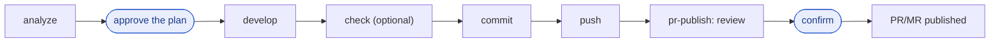

# devkit

English | [한국어](README.ko.md)

A Claude Code team dev kit that sets up the same development workflow in any repository and any business domain. It ships no project rules up front and depends on no task tracker (Jira, Notion, Obsidian, GitHub Issues …). It contains the **workflow** (analyze → implement → verify → commit → push → PR/MR), **working principles** (minimal scope, claim only what was checked, optional verification, human approval points), and **tools that grow evidence-based rules and skills for each repository**.

Skills and docs are written in English; Claude answers in the language of each request (Korean in, Korean out; English in, English out), a rule the session hook injects and the language hook repeats on every prompt, and `devkit:setup` writes repository docs in the language chosen in its interview.

## What's inside

| Stage | Name | What it does |
|---|---|---|
| Always | Session hook `using-devkit` | Injects the judgment principles (7 lines) at session start, resume, clear and compaction. A repo's `CLAUDE.md` and `docs/rules/` take precedence |
| Always | Language hook `hooks/user_prompt.py` | Adds one line to every prompt: write progress updates, questions and the final answer in that prompt's language, whatever it is. Turn off: `/plugin` > devkit > Configure options > Language reminder, or `DEVKIT_LANG_HOOK=off` in the settings `env` |
| Always | Guard hook `hooks/guard.py` | Enforces Git and server-start rules in code right before shell commands run (see "Guard hook") |
| Analyze | `/devkit:analyze` | Reads a requirement, issue or bug from any source; traces current code → gap → impact → common risk check → implementation plan in an analysis doc; asks for approval |
| Implement | `/devkit:develop` | Implements the approved plan, DB change and rollback SQL (`00_check` → `01_change` → `99_rollback`, run by a person), verification and regression check, per-requirement report |
| Verify | `/devkit:check` | Finds lint, type, build and test commands and runs only the related ones (user-invoked only) |
| Commit | `/devkit:commit` | Commits named files following the repo's Git rules |
| Push | `/devkit:push` | Checks outgoing commits and whether the remote is ahead, blocks protected-branch and force pushes, then pushes |
| PR/MR | `/devkit:pr-publish` | Review → title and body draft → confirmation → create or update the PR/MR with `gh`/`glab`. Pins the remote SHA, publishes only what it reviewed and stops if the remote moved |
| Parallel | `/devkit:parallel-work` | Splits a request into independent tasks and runs them in parallel workers (subagents; Orca or Herdr sessions when started inside those terminals), each edit task in its own git worktree. After confirmation it commits, merges, runs the integrated check and cleans up |
| Cleanup | `/devkit:clean-temp` | Lists temp files left during work (dry-run folders, `.bak`/`.tmp`, root temp scripts, captures) and other sessions' scratchpads, and moves only the chosen ones to the OS trash. Never touches tracked files or protected paths; repo-specific protections go in `.devkit/clean-temp/config.json` (user-invoked only) |
| Review | `/devkit:peer-review` | Reviews teammates' commits on a shared branch since the last review (commit format per `docs/rules/`, must-fix vs optional defects), drafts per-developer feedback and tracks findings until fixed |
| Setup | `/devkit:setup` | Lays down the shared rules skeleton `docs/rules/` (common, Git, environments; layer docs and onboarding when needed), the local router `CLAUDE.md` and `.gitignore` |
| Setup | `/devkit:suggest-skills` | Proposes rule rows, project skills and agents from code pinpoints, repeated tasks and user corrections; builds only the chosen ones |
| Setup | `/devkit:improve-skill` | While you work in a project, fixes one of that project's own skills (e.g. `.claude/skills`) that you keep correcting: checks it for overlap with the skills you already use, diagnoses each correction against the authoring rules, edits only that skill after approval and checks it. Not for plugin or user-level skills (user-invoked only) |
| Explore | Agent `devkit:code-reader` | Handles multi-file exploration and returns only conclusions (Sonnet, read-only) |

The common risk checklist in `analyze` covers failure points that recur in every domain. It answers only the questions this change touches, with `file:line` evidence or `needs confirmation`:

| Area | Sample question |
|---|---|
| Data and transactions | What is left behind if it fails half-way? |
| Concurrency and duplicates | What if two people change it at once, or the same request arrives twice? |
| State | Does a cancel reverse every trace of the original? |
| Numbers and time | Where does rounding happen? Which time zone is "today"? |
| Permissions and security | Can changing an ID expose someone else's data? |
| External integrations | If the other side does not answer, how is the result confirmed? |
| Volume and performance | Is the DB called once per list row? |
| History and operations | Is who changed what recorded? Can a failure be rerun? |
| Deployment and compatibility | Does old code run on the new schema? Can it be rolled back? |
| Display and errors | Is a failure hidden as success? |

Blueprints `suggest-skills` proposes when the conditions fit: a project-specific flow skill (adds this repo's own steps on top of `analyze` and `develop`), `db-analyst`, `knowledge-reader` and `spec-analyst` agents, `visual-docs`, and external-tool skills.

## Workflow

Every repository follows the same order. A person decides at the highlighted points.



1. First time in a repo: `/devkit:setup` → answer a few interview questions and approve the setup plan to get the rules skeleton.
2. Per task: `/devkit:analyze <issue link, file or requirement>` → approve → `/devkit:develop` → `/devkit:check` if needed → `/devkit:commit` → `/devkit:push` → `/devkit:pr-publish`.
3. As a reviewer: `/devkit:peer-review` → review what teammates pushed to the shared branch since last time. The first run builds `.devkit/peer-review/config.json` from `docs/rules/git.md`.
4. Several independent requests at once: `/devkit:parallel-work <numbered requests>` → approve the task split → workers run in parallel → confirm commit, merge and the integrated check.
5. Occasionally: `/devkit:suggest-skills` → get evidence-backed candidates for this repo's rule rows, skills and agents, and build only the chosen ones. Claude suggests it once when the same task repeats or the same correction is given twice. To fix a project skill you keep correcting, run `/devkit:improve-skill <name>`.

Analysis docs and work SQL live in `<repo>/.devkit/work/<task ID>/` (excluded from Git).

## Setting up a repository

`/devkit:setup` reads the repository first and asks only what it cannot find out.

| Step | What happens |
|---|---|
| 1. Scan | A script collects sub-projects, runtimes and ports, CI, DB type and the existing commit convention |
| 2. Interview | Asks only what the scan cannot settle, in two or three rounds, each question with a recommended answer |
| 3. Plan approval | Shows the list of files to create. Nothing is written before approval |
| 4. Write | Writes only what has evidence. Existing docs are extended, not overwritten |
| 5. Check | Looks for broken links, secret-shaped values and unfilled placeholders |

Questions the interview asks, for example:

- May Claude start and stop the servers?
- Who runs DB write SQL?
- How far may Claude go with commit, push and PR?
- Add AI attribution to commits and PRs?
- Will every teammate use devkit?
- Are the local ports and profiles found in the scan right?

What the repository gets:

```text
my-repo/
├─ docs/rules/              # in Git: the single source of team rules
│  ├─ README.md             #   index
│  ├─ common.md             #   working principles, what to ask first, running, verification
│  ├─ git.md                #   commit format, branches, PR/MR, never-do list
│  ├─ environments.md       #   local and deploy values with their sources
│  └─ backend.md …          #   layer docs, when needed
├─ docs/guide/              # in Git: onboarding for new teammates (optional)
├─ .gitignore               # lines added for local files
├─ CLAUDE.md                # local by default: links to docs/rules only
└─ .claude/settings*.json   # AI attribution setting: settings.json if the whole team uses devkit, else settings.local.json
```

`CLAUDE.md` copies no rules and only links to `docs/rules/`, so there is one place to change a rule.

### Rolling out to a team

Each person installs devkit; setup runs once per repository.

| Who | Steps |
|---|---|
| First person | Install devkit → `/devkit:setup` in the repo → commit and push the created files |
| Everyone else | Install devkit → `git pull` → start with `/devkit:analyze`. No setup needed |

devkit skills read `docs/rules/` directly. To change a rule for everyone, edit that folder and commit.

## Requirements

**Python 3.8+, available as the `python3` command.** Hooks, scans and checkers all run on Python. No other runtime (node, bash, PowerShell) is needed.

| OS | Install | Check |
|---|---|---|
| macOS | Included (otherwise `xcode-select --install` or `brew install python`) | `python3 --version` |
| Linux | Distribution package (`apt install python3` etc.) | `python3 --version` |
| Windows | Python install manager from python.org, or Python from the Microsoft Store | `python3 --version` in a new terminal |

The legacy python.org installer for Windows does not provide a `python3` command; reinstall with the install manager. If running `python3` opens the Microsoft Store, Python is not installed yet.

## Install

Needs: Claude Code, Python 3.8+, Git. `gh` or `glab` for publishing PRs/MRs.

From GitHub ([JQ-WCoding/devkit](https://github.com/JQ-WCoding/devkit)):

```bash
claude plugin marketplace add JQ-WCoding/devkit
claude plugin install devkit@devkit
```

Inside a session: `/plugin marketplace add JQ-WCoding/devkit`, then `/plugin install devkit@devkit`. Restart Claude Code after installing.

From a zip file (for teammates without access to the GitHub repo):

1. Unzip `devkit.zip` somewhere permanent, not a downloads folder you clean up; updates reuse this folder. The `.claude-plugin` folder must sit directly inside it (if unzipping created `devkit/devkit/`, use the inner one).
2. Register and install:

   ```bash
   claude plugin marketplace add <unzipped folder>
   claude plugin install devkit@devkit
   ```

3. Restart Claude Code and type `/devkit:`. If skills such as setup, analyze and commit appear, it is installed.

To update from a new zip, delete the old folder, unzip the new one in the same place, then run the update commands below.

Update: `claude plugin marketplace update devkit`, then `claude plugin update devkit@devkit`, then restart Claude Code.

## Enable by default in a team repo

Optional, by hand: `devkit:setup` does not write these keys, because teammates who got devkit as a zip may not reach the GitHub repo. If every teammate can reach it, add this to the team repo's `.claude/settings.json` (tracked in Git). When a teammate trusts the repo, the marketplace is registered and the plugin is enabled.

```json
{
  "extraKnownMarketplaces": {
    "devkit": { "source": { "source": "github", "repo": "JQ-WCoding/devkit" } }
  },
  "enabledPlugins": { "devkit@devkit": true }
}
```

- For a mirror on another Git host: `{ "source": "git", "url": "https://<host>/<group>/devkit.git" }`.
- Each teammate may need to download it once with `claude plugin install devkit@devkit --scope project`.
- In that case set `.gitignore` to `.claude/*` plus `!.claude/settings.json` rather than ignoring all of `.claude/` (`devkit:setup` asks about this in its interview).

## Guard hook

Rules that must hold every time, without exception, are enforced in code (deterministic) rather than prose (advisory). Prose keeps only the principles that need judgment, which cuts per-session tokens. The hook runs `python3` directly without a shell (exec form), so it behaves the same on macOS, Linux and Windows.

| Decision | Commands (Bash and PowerShell tools) |
|---|---|
| Deny | `git add .`, `-A`, `-u`; `git commit -a`, `-n`, `--no-verify`; `git push -f`, `--force`, `+ref`, `--no-verify`; commit messages containing AI attribution (`Co-Authored-By: Claude`, `Generated with Claude Code`) via `-m`, heredoc or a `-F` file |
| Ask | `--force-with-lease`, `--amend`, pushes to protected branches (`main`, `master`, `release/*`, `prod*`), server and container starts (`bootRun`, `spring-boot:run`, `npm run dev`, `docker compose up` etc.) |

- Turn off: `/plugin` > devkit > Configure options > Git guard (per user), or `DEVKIT_GUARD=off` in the settings `env` (use this to set it for a whole repo). Restart Claude Code after changing an option.
- Repos that want AI attribution: `DEVKIT_AI_TRAILER=allow` in the settings `env`.
- The setting that stops attribution from being written at all (`"attribution": {"commit": "", "pr": ""}`) is written by `devkit:setup` according to the interview answer.
- A guard error never blocks work (`onFailure: continue`). Ambiguous commands pass (missed detection over false positives).
- Tests: `python3 -I hooks/guard_test.py`

## Changing principles or adding skills

- Working principles: `skills/using-devkit/SKILL.md`. It goes into every session, so keep only short judgment rules there. Rules that code can decide go into `hooks/guard.py`, with cases in `guard_test.py`.
- New skills: follow `skills/suggest-skills/references/skill-authoring.md` and check with `python3 -I skills/suggest-skills/scripts/check_skill.py skills/<name>`.- Manifest check: `claude plugin validate .`
- The installed copy is per version. To ship changes to the team, bump `version` in `.claude-plugin/plugin.json` (`plugin update` ignores changes at the same version).
- Anything that differs per project (module names, paths, naming) does not belong in devkit. Put it in each repo's `docs/rules/` and `.claude/`.

## Status

0.7.0 · 2026-11-12. Released under the MIT License (see `LICENSE`).
